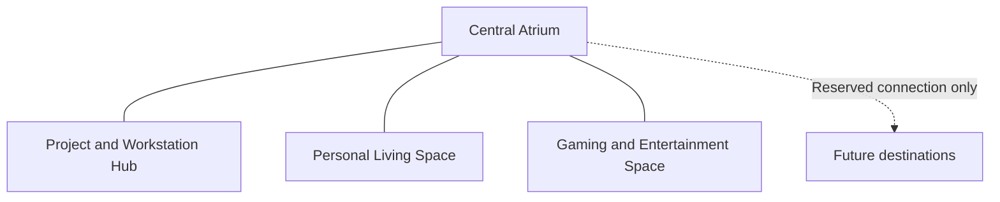

# AURA world vision

Status: requirements captured at Milestone 0. Art direction and architectural
plans are planned for M1; these are not completed rooms or final visual decisions.

## One application, connected physical destinations

The central Atrium connects a Project & Workstation Hub, a separate Personal Living
Space and a separate Gaming & Entertainment Space. Hardware, Software, AI/LLM,
GitHub and Companion are functions inside the same Project Hub. They are not five
new buildings, and the personal spaces do not duplicate native developer services.

This is the required logical adjacency, not a scale floor plan. M1 must author a
plan with dimensions, room transforms, connection widths, doors, floor continuity,
walkable clearance, collision boundaries, camera views and asset footprints before
M3 implements it. Expansion reservations need metadata, not unused modeled rooms.

## Room identities requested by the owner

| Physical space | Direction and purpose |
|---|---|
| Atrium | Architectural stone/glass, cobalt, sunset warmth and greenery; clear entrances, map, wayfinding, Astra access |
| Project Hub | Graphite/brushed metal, teal/copper/amber; believable PCs, peripherals, chairs, hardware inspection and real project/AI/GitHub screens |
| Living | Walnut/oak, terracotta, forest green, amber/gold, soft cream/stone/fabric; comfortable seating, plants, books/art, lights/curtains and approved interior options |
| Gaming | Indigo/charcoal, cobalt/violet/cyan with restrained coral/magenta; licensed gaming setup, console/display, arcade, seating and honest modular launcher |

High-quality stylized realism, convincing silhouettes, material differentiation,
human scale, calm composition and clear interactions take priority over polygon
count, bloom or excessive neon. Keep global UI restrained and readable; the world
can have richer colour than the current light studio. Prioritize 1100×700 through
large Mac desktop windows, with dismissible panels and the scene as centerpiece.

## Questions M1 must resolve

- Overall floor plan and coherent architectural vocabulary; doorway sightlines and
  paths that avoid crowded furniture and Astra occlusion.
- Scale reference around the existing 1.75 m avatar and a comfortable explore eye
  height; generous movement and seated inspection space.
- Room-specific material boards and day/sunset/night lighting studies, calibrated
  within one sRGB/ACES rendering workflow.
- Hero asset requirements and visual acceptance views: PC chassis/interior/fans,
  desk/chair/keyboard/mouse, living sofa, gaming/arcade equipment and architecture.
- Screens as readable work surfaces driven by actual permitted state; clearly
  labelled local illustrations where no data exists.
- Compact HUD/map, discoverable interactions, accessible direct travel and a calm
  motion language with instant/short reduced-motion alternatives.
- Astra's physical placement and access across destinations, retaining one companion
  service and avoiding an assumed walking animation that the original rig lacks.

## Scope boundaries

Preserve Astra, native voice (including Pause/Resume/Replay and pace fixes), GitHub,
source approvals, provider credentials and existing native shortcuts. No telemetry
invention, frontend provider service, browser microphone capture, streaming-service
claim, uninstalled playable game, remote runtime asset CDN or commercial game copy.
No local-model management service this phase: only an extension location using the
existing provider configuration where available.
